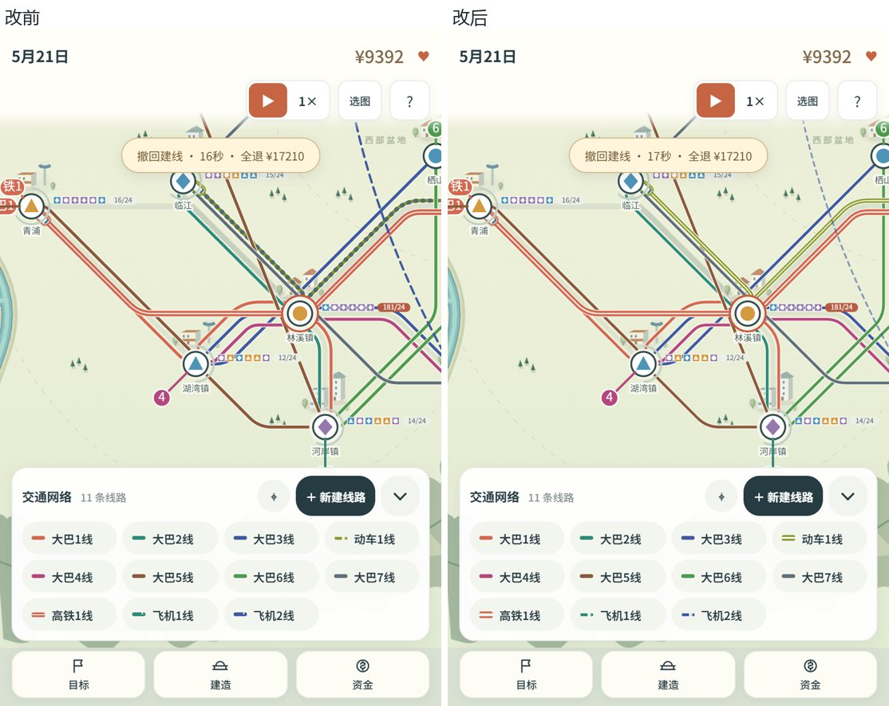
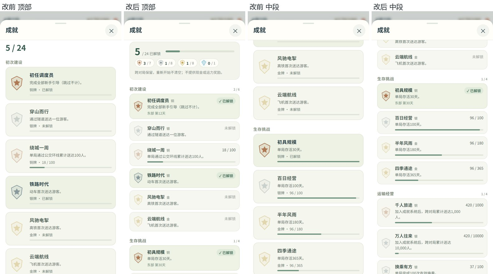
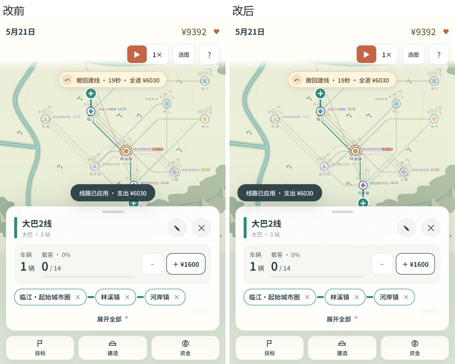
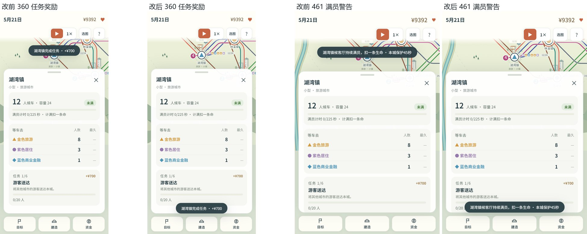

## 范围

基于上游 v1.4 `57d1284`，提交本轮已验收的体验层整理，以及后续审计发现的镜头、通知、颜色持久化和线路提交修复。保留 v1.4 成就、西部盆地和单击选线编辑；不修改经济数值、存档键或历史入口，不包含网站部署和 APK 构建。

### 已验收的界面整理

- 交通网络托盘支持完整显示后期多线路，收起后按编号/颜色直接选线；线路端点与托盘编号对应。
- 后期地图减少候车与任务信息堆叠；城市详情优先显示候车负荷，共线城市先选择线路或查看城市。
- 中心页框架与页签稳定，修正横屏活动卡裁切、次要页面空状态和帮助说明；成就页改为解锁汇总、分类计数和紧凑条目，宽屏两列，保留一个吸顶关闭入口。
- 保持上游当前地图方向；改进包含竖屏、横屏和桌面，并非仅竖屏样式变化。

- 后期地面线路采用圆角折线、短距离收拢的并行车道和车站留白；需桥/隧道的线段、桥头和航空保持直线。公交细实线、动车/高铁双轨、航空淡虚线，托盘线型同步。
- 施工与断线标签跟随新的道路路径；桌面悬停高亮线路。竖屏选线面板最高半屏；编号与延长入口避让城市文字。
- 通知、撤回和边缘指示统一胶囊样式；撤回并入顶部状态列。通知增加类别图标，保留原通知文字和关闭生命周期；面板下的新城仍有边缘指示。
- 竖屏城市详情全展开后隐藏重复的设施快捷条，设施卡片入口保留；城市任务改为浅底卡片。
- 瞬时提示按城市节点半径避让所选城市和线路端点，覆盖竖屏、横屏和桌面。竖屏全展开时，真实长奖励/满员警告若在地图中放不下，短暂放到详情底部、按钮栏上方；会暂盖部分面板内容，不拦截点击。

### 逻辑修复

- **镜头恢复**：关闭最后一个详情/选线面板后按会话恢复视图，避免软边界回推被当作玩家手动移动；玩家主动平移/缩放后不强制拉回，开始拉线不跳镜头。
- **颜色预览**：预览不写入游戏状态，取消、关闭和未保存刷新均保留原色；只有保存设置才持久化。
- **通知生命周期**：只为后写入的活动与城市倒计时管理关闭状态，绑定所属活动/阶段、城市和当前游戏实例；天气、施工仍使用上游生命周期。修复关闭第一场雨后新雨不再提示、关闭活动误关底层天气、跨局重用活动 id 误继承关闭记录。
- **线路提交**：旧 `commitDraft(false)` 报价确认入口不再提前重置车辆运营计划；只在实际提交成功后更新。网页和安卓 `web-base127` 同步修复，取消、资金不足和无效编辑保留原计划。

- **跨存档路径缓存**：审计发现相同线路类型/站点编号会复用另一张地图的城市坐标，造成线路和车辆跑离车站。路径缓存现绑定当前游戏状态，在节流前处理切图、重开与读档，保留同局绘制缓存。

## 验证

### 2026-11-11 追加：`bbbe8d7`、`e49e07f`

- `bbbe8d7` 的设施条去重、任务卡片和通知图标定向检查通过；其长提示遮挡问题由 `e49e07f` 修复并独立复验关闭。
- 重新走产品实际任务完成和满员扣命流程：360×740、390×844 的「湖湾镇完成 游客送达 · +¥700」，以及 461×709 的满员长警告，均不遮住城市节点。新增回归使用长提示文本和节点半径，不再只测四字提示。
- 五尺寸独立浏览器检查共 8 个有效提示场景通过，包含 844×390、1440×900 的四站线路反馈与端点避让；页面无错误。提示正常淡出，底栏按钮未被遮挡。
- 已执行 `mobile prepare:web`；`ux-layer.cjs` **51/51** 通过，diff 检查通过。本次是定向复验，未重跑全部 26 套、全部浏览器断言或触摸 E2E；只用鼠标，未做真机测试。

### 已交付基线 `a10aef5` 的独立验证

- `a10aef5` 重新执行 26 套 Node 测试，全部通过（含准备后的 Android 网页层）；`release14-dom.cjs` 新增真实存档切换与读档缓存回归。旧代码 `52a8c61` 端点偏离约 626.50 世界单位，修复后立即切图及 1000ms 后都对齐车站。
- 本轮独立浏览器检查覆盖 390×844、360×740、461×709、844×390、1440×900：后期网络、施工/断线标签、拖动延长后的报价与取消、付款提示避让、末尾色块可点击、详情展开、成就页滚动、横屏关闭详情后镜头恢复。未捕获页面错误。本轮使用鼠标，未做真机触摸。
- 完整网页 32 脚本几何探针：18 个弯曲路段中点，在选中/未选状态下 36 次均命中正确线路；scale=.66，实际笔画采样与理想轨迹最大几何偏差约 0.20 CSS px（不含抗锯齿），不称逐像素零偏差。
- 实现方此前报告五尺寸浏览器断言、模拟触摸端到端和 220 张截图通过；本轮独立验收为上述定向检查，没有重复执行该整套截图/触摸脚本。
- 此前已验收的通知生命周期、颜色取消/保存、线路提交资金/资产一致性、存储失败恢复等证据继续有效。通知旧版 3 项回归失败、报价旧版提前修改运营计划失败，均已修复。
- 本轮执行 `mobile prepare:web` 并运行相关 DOM/原生网页层测试；此前 `cap sync android` / `verify` 通过的资源引用证据继续有效。本轮未构建 APK，未测系统返回键或真实双指手势。

## 说明和对比图

- [设计与后续修复记录](../../.agents/notes/implemented/feature/2026-11-08-design-pass.md)
- [线路提交决策](../../.agents/notes/implemented/bug-fix/2026-11-09-route-edit-commit.md)
- [复验工具说明](verify/README.md)
- `01–08` 保留早期对比；`09–14` 为后期线路及交通方式，`15–19` 为成就/胶囊，`20` 为竖屏提示避让，`21` 为本次全展开详情长提示的实现方前后对比。图片按各自提交的同场景比较，不冒充所有变更同时发生。

