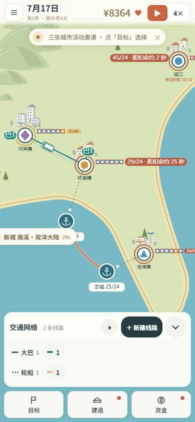
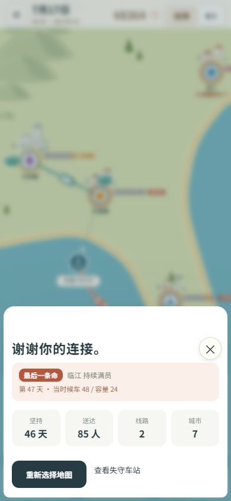

## 这轮改了什么

基于上游 v1.6.5（`6c0afa0`），改动面向正式入口 `dist/index.html`。建议先试玩双洋大陆：从建港、开线一直玩到结算，三个改动可以在同一局里看到。

- **建港、开船**：沿海城市在设施栏首位显示「建港口 ¥1500」，半展开和全展开都能操作。只有一座港时提示再建一座；建好第二座后可拖到另一港，查看船舶报价再确认。设施解锁通知等退出详情再弹，不打断手上的操作。
- **抢救满员车站**：剩余时间按当前倍速换算为实际秒数。屏幕边缘的危急标签会换位置，避免被裁掉或盖住邻站；扩容或疏运解除满员后，倒计时收回。
- **看清输在哪里**：结算显示实际扣掉最后一条命的车站、当时的候车人数和容量。「查看失守车站」直接定位；结束局不再倒数、提示新城即将开放或允许花钱建港。
- **线路编辑与报价**：竖屏托盘按交通方式分组；选中线路后可以移除多个站点或重画。跨河时优先复用合适的桥，确需新桥时把桥费列入底栏总价，确认后一起建设、撤回时一起退款。修正旧报价遮挡手动建桥、教程指错站和继续游戏后仍提示暂停的问题。

## 两局自然试玩

| 竖屏 | 实际操作 | 结算 |
| --- | --- | --- |
| 360×740 | 建两港、一条船线；河岸镇 38 人候车时暂停，把容量从 24 扩到 48，解除警告。 | 坚持 37 天，送达 25 人；第 38 天林溪镇失守，41/24。结算定位林溪镇，而不是刚抢救过的河岸镇。 |
| 390×844 | 船线接上公交；第 23 天读档，继续经营原网络。 | 坚持 46 天，送达 85 人，2 线、7 城；第 47 天临江失守，48/24。 |

## 验证与边界

- 本轮跑通 `npm test` 的 27 个脚本；后续修复定向复验了海港、终局和界面状态。Android 网页资源经 `prepare:web` 准备，`native130-dom` 通过。
- 360×740、390×844、461×709 三种竖屏检查了建港入口、终局不扣费、失守定位、警告消失与边缘避让。461 后期网络使用固定场景，与以上两局自然成绩分开。[浏览器复验工具](verify/README.md)
- 本轮未测真机、未构建 APK。活动邀请的弹出策略留到下一轮，不影响这次建港、抢救、结算的验收。

[上一轮 v1.4 的交付说明与对比图](https://github.com/MayRain-Meow/transit/blob/e3453b95da2156145e66e0d4ea589c6377c70883/artifacts/design-pass-1210/PR_BODY.md)
